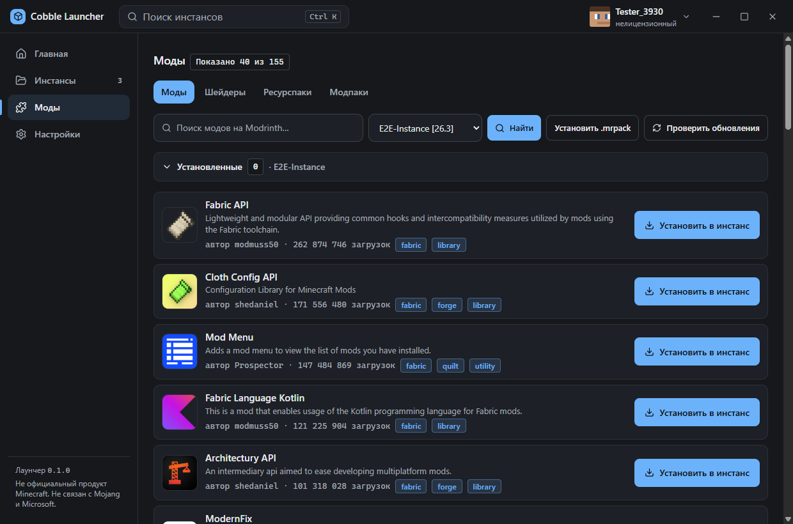
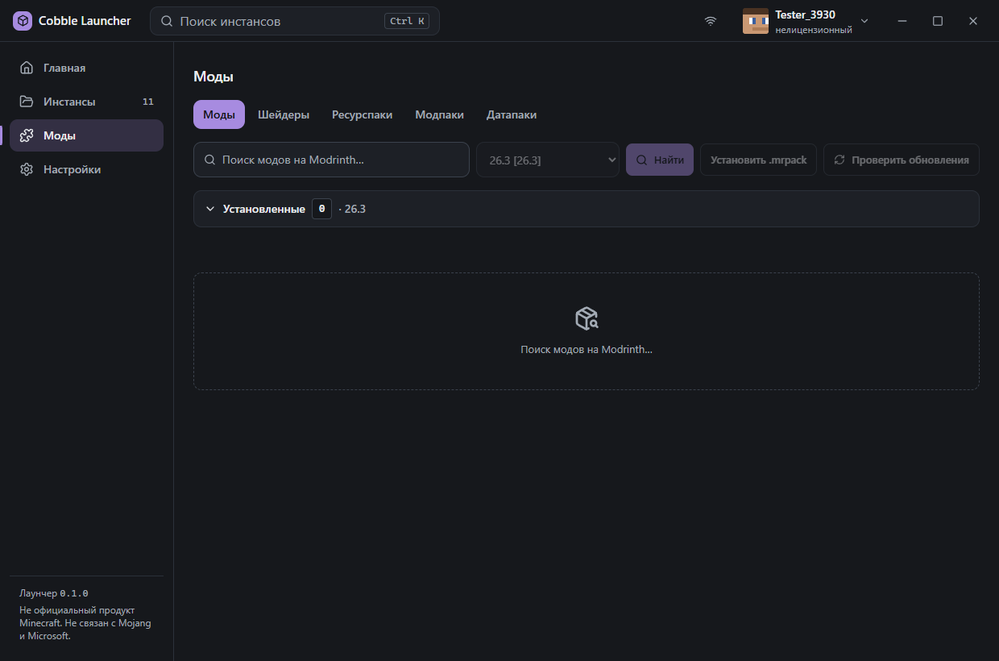
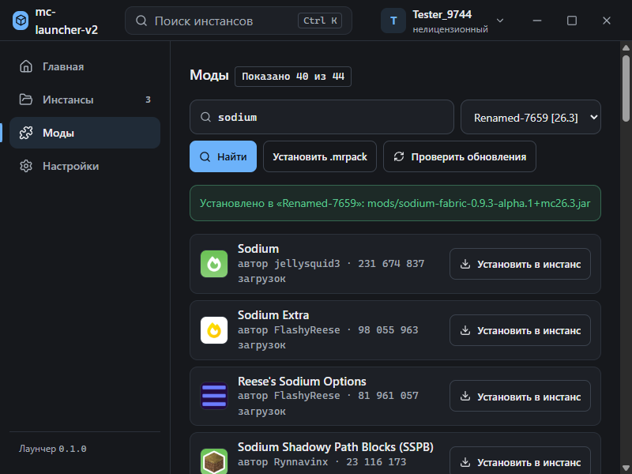

<div align="center">

# Cobble Launcher

**Быстрый и честный лаунчер Minecraft для Windows**

Tauri 2 · Rust · React 19 · TypeScript

</div>

---

Cobble — настольный лаунчер с нативным ядром на Rust и лёгким интерфейсом на React. Никаких браузерных движков в фоне, никаких «ускорителей» и инжекций в игру: только официальные источники, проверка каждого файла по хэшу и sodium-стек для оптимизации.

<div align="center">
  
</div>

## Возможности

**Инстансы**

- Изолированные инстансы: своя версия, загрузчик (Fabric / Quilt / Forge / NeoForge), моды и настройки
- Полный контроль инстанса: RAM, версия Java, JVM-флаги, аргументы игры, переименование, дублирование
- Защита данных: запущенный инстанс нельзя удалить, переименовать или повредить; двойной запуск исключён на уровне ядра

**Моды и контент**

- Каталог Modrinth с поиском, фильтрами и бесконечным скроллом
- Установка модов и модпаков `.mrpack` в один клик
- Пакетная проверка и обновление установленных модов
- Оптимизация по sodium-стеку — без «бустеров» и правок игры

**Профили и аккаунты**

- Microsoft (честный браузерный OAuth), Ely.by (authlib-injector) и офлайн-профили
- Офлайн-профили всегда честно помечены как нелицензионные
- Refresh-токены хранятся только в системном keyring

**Диагностика**

- Живой просмотрщик логов с автопрокруткой
- Автоматический анализ крашей: устаревшая Java, нехватка памяти, конфликт модов — с конкретными рекомендациями
- Просмотр latest.log и буфера игры без открытия папок вручную

**Оформление**

- Темы «Сланец», «Глубинный сланец», «Дальтоник» и другие — 5 палитр на выбор
- Полная поддержка клавиатуры: Ctrl+K для поиска, Escape, фокус-навигация
- Интерфейс на русском и английском

<div align="center">
  <table>
    <tr>
      <td></td>
      <td></td>
    </tr>
  </table>
</div>

## Безопасность и приватность

- **Только официальные источники**: Mojang, Modrinth, Adoptium — каждый файл сверяется по хэшу с сервера. Зеркала без проверки хэшей запрещены по принципам проекта.
- **Ноль инжекций в игру**: лаунчер не модифицирует процесс Minecraft. Единственное исключение — authlib-injector для Ely.by, работающий в рамках этой службы.
- **Секреты не покидают систему**: токены — в keyring Windows, в логах включено автоматическое скрытие секретов.

## Сборка из исходников

Требуется Node.js 20+, Rust (stable) и пакетный менеджер npm.

```bash
npm install        # зависимости фронтенда
npm run tauri dev  # запуск в режиме разработки
```

Релизная сборка (установщики NSIS и MSI в `src-tauri/target/release/bundle/`):

```bash
npm run tauri build
```

Проверки качества:

```bash
npm run build                # TypeScript strict + Vite
cd src-tauri && cargo test   # 96 тестов ядра и движка загрузок
```

## Стек и структура

| Слой | Технологии |
|---|---|
| Интерфейс | React 19, TypeScript strict, Tailwind 4 |
| Ядро | Rust, Tauri 2, tokio |
| Контент | Modrinth API, манифесты Mojang, Adoptium |

- `src/` — интерфейс: страницы, компоненты, темы, i18n (ru + en)
- `src-tauri/src/` — ядро: инстансы и запуск, загрузки по хэшам, Modrinth, авторизация
- `docs/` — [карта документации](docs/README.md): [контракт ядро↔UI](docs/UI-CONTRACT.md), [реестр решений](docs/DECISIONS.md), [статус этапов](docs/PROGRESS.md), [реестр аудита](AUDIT.md)
- `scripts/` — приёмочные тесты: сквозные проверки UI, жизненного цикла процесса, интеграции Modrinth
